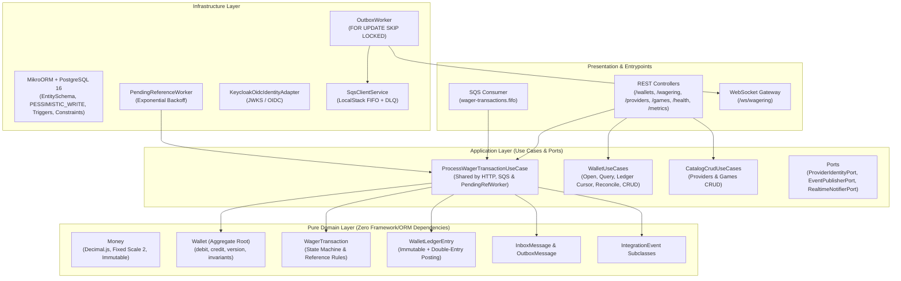
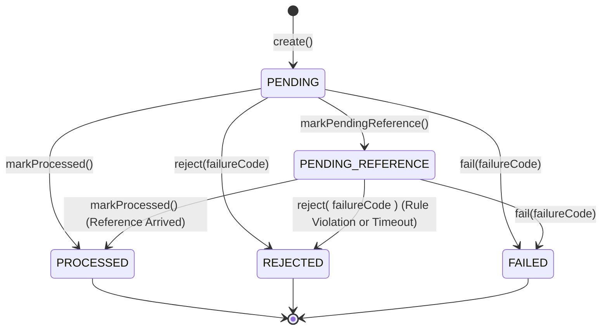

# Architecture & Technical Decisions — Distributed Wagering Processor

Este documento detalha as decisões arquiteturais, estratégias de concorrência, precisão monetária, idempotência, mensageria, extensões de CRUD/WebSockets, trade-offs e limitações do **Distributed Wagering Processor**.

---

## 1. Visão Arquitetural (DDD + Hexagonal / Clean Architecture)

O sistema foi desenhado separando estritamente **regras de negócio puras** de **detalhes de infraestrutura e transporte**:

### Garantias de Isolamento do Domínio
- As classes em `src/domain/` **não importam** `@nestjs/*` nem `@mikro-orm/*`.
- Construtores das entidades e objetos de valor são `private` ou `protected`.
- A criação de novas instâncias valida invariantes através de factories estáticas (`Money.from`, `Wallet.open`, `WagerTransaction.create`, `WalletLedgerEntry.create`, `InboxMessage.receive`, `OutboxMessage.enqueue`), enquanto a reconstrução a partir do banco utiliza exclusivamente `rehydrate()`, sem reexecutar regras de transição.

---

## 2. Escolha do ORM, Mapeamento de `Money` e Estratégia Transacional

### 2.1 Escolha do ORM: MikroORM (Preferencial)
Adotamos o **MikroORM** (`@mikro-orm/postgresql`) utilizando `EntitySchema` em `src/infrastructure/persistence/entities/orm-entities.ts` e mappers explícitos em `DomainPersistenceMapper`.
- **Por quê?** O MikroORM oferece controle explícito sobre `EntityManager.transactional()`, `LockMode.PESSIMISTIC_WRITE`, `LockMode.PESSIMISTIC_READ` e acesso direto à conexão transacional (`txEm.getTransactionContext()`) para queries `FOR UPDATE SKIP LOCKED`, mantendo as classes de domínio livres de decorators de persistência.

### 2.2 Representação e Persistência de `Money`
- **Em memória (Domínio)**: `Money` encapsula uma instância de `Decimal` (`decimal.js`) e o código ISO-4217 da moeda (`currency`). A instância é congelada com `Object.freeze(this)` e toda operação (`add`, `subtract`, `negate`) retorna uma nova instância de `Money`.
- **Validação de Entrada**: `Money.from(props)` valida estritamente via expressão regular `/^\d+\.\d{2}$/` e `/^[A-Z]{3}$/`, rejeitando `number`, `NaN`, `Infinity`, notação científica (`1e5`), strings vazias, escala diferente de 2 casas decimais e valores negativos.
- **No Banco de Dados (PostgreSQL)**: Persistido em colunas separadas `NUMERIC(20, 2)` (precisão exata em base 10 no PostgreSQL) e `VARCHAR(3)` para a moeda. Nunca há conversão intermediária para `float`/`double`/`number`.

### 2.3 Estratégia Transacional Atômica
Toda operação financeira (seja via HTTP, fila SQS ou worker de referência pendente) executa dentro de uma única transação SQL (`em.transactional()`):
1. Registro e marcação na tabela `inbox_messages` (quando originada do SQS);
2. Aquisição de lock pessimista (`SELECT ... FOR UPDATE`) na linha da `Wallet`;
3. Persistência ou transição de estado em `wager_transactions`;
4. Atualização de `balance_amount` e incremento de `version` em `wallets` (somente quando o saldo muda);
5. Inserção append-only em `wallet_ledger_entries` (quando há efeito financeiro);
6. Inserção dos eventos de integração serializados em `outbox_messages`.

Se qualquer passo falhar, o PostgreSQL executa `ROLLBACK` de toda a unidade de trabalho, garantindo atomicidade total.

---

## 3. Concorrência e Ordenação por `walletId` (Seção 8)

### 3.1 Estratégia Escolhida: Pessimistic Write Lock (`SELECT ... FOR UPDATE`) + Versionamento
A unidade de concorrência do sistema é exclusivamente a `walletId`.
Ao processar qualquer transação para uma `walletId`, o caso de uso adquire `LockMode.PESSIMISTIC_WRITE` (`SELECT ... FROM wallets WHERE id = $1 FOR UPDATE`) na linha da carteira correspondente.

### 3.2 Justificativa e Trade-offs (Pessimistic vs Optimistic Locking)
- **Hot Wallets**: No domínio de iGaming, uma mesma carteira frequentemente recebe rajadas concorrentes (múltiplos cliques, eventos de rodada próxima ou redeliveries simultâneos em diferentes instâncias). Com *Optimistic Locking* puro, $N$ requisições concorrentes na mesma wallet resultam em $N-1$ falhas de versão e retries em cascata. Com `SELECT ... FOR UPDATE` na linha da `walletId`, o próprio PostgreSQL enfileira as transações daquela carteira na ordem de chegada do lock, resolvendo a contenção em uma única passagem e garantindo determinismo no cenário obrigatório (`100.00 BRL` disputado por duas apostas simultâneas de `80.00 BRL` → exatamente uma `PROCESSED`, uma `REJECTED` por `INSUFFICIENT_FUNDS`, saldo final `20.00 BRL`).
- **Isolamento entre Carteiras**: Como o lock é por linha (`WHERE id = :walletId`) e **não** um lock de tabela ou lock global em memória, operações de jogadores/carteiras diferentes executam 100% em paralelo entre as $\ge 3$ instâncias da aplicação.
- **Versionamento (`version`)**: A coluna `version` inicia em `1` na abertura da carteira e é incrementada **somente quando o saldo muda**, sendo propagada também no evento `WalletBalanceChanged` (`walletVersion`) para permitir que consumidores downstream detectem a ordem exata das mutações de saldo.

---

## 4. Idempotência Persistente e JSON Canônico (Seção 9)

### 4.1 Algoritmo de `payloadHash` (JSON Canônico)
Implementado em `src/domain/shared/canonical-json.ts`:
1. Extrai apenas o subconjunto de campos de negócio da operação (`externalTransactionId`, `gameId`, `kind`, `money: { amount, currency }`, `playerId`, `providerId`, `roundId`, `walletId` e, se presente, `referenceExternalTransactionId`). Headers HTTP e metadados de transporte (`correlationId`, `messageId`) são excluídos.
2. Ordena recursivamente todas as chaves dos objetos em ordem lexicográfica UTF-16 (`toCanonicalJson`), produzindo uma string JSON determinística sem espaços supérfluos.
3. Calcula o digest **SHA-256** em hexadecimal (`computeWagerPayloadHash`).

### 4.2 Garantias de Replay vs Conflito
- A tabela `wager_transactions` possui `UNIQUE (idempotency_key)` e `UNIQUE (provider_id, external_transaction_id)`.
- Quando uma requisição repete uma `Idempotency-Key` existente:
  - Se `existingTx.matchesPayload(payloadHash)` for `true`: retorna a resposta original com `idempotentReplay: true` e o **`observedBalance` gravado no momento em que a transação original foi processada** (cumprindo a Regra 7 da Seção 7 mesmo que a carteira tenha sofrido outras movimentações posteriores).
  - Se `existingTx.matchesPayload(payloadHash)` for `false`: lança `IdempotencyConflictError`, retornando HTTP `409 Conflict` (`IDEMPOTENCY_PAYLOAD_MISMATCH`).

---

## 5. Máquina de Estados, Referências Fora de Ordem e Taxonomia de Falhas (Seção 7)

### 5.1 Máquina de Estados de `WagerTransaction`

`PROCESSED`, `REJECTED` e `FAILED` são estados **terminais**. Qualquer tentativa de transição a partir deles lança `InvalidTransactionStateError` na camada de domínio e é bloqueada no banco pela trigger `trg_prevent_terminal_tx_mutation`.

### 5.2 Tratamento de Referências Fora de Ordem (`PENDING_REFERENCE`)
1. Quando um `REFUND` ou `ROLLBACK` (ou `WIN`/`LOSS` com referência informada) referencia uma `externalTransactionId` que ainda não existe ou ainda não atingiu estado terminal, a transação é persistida com status `PENDING_REFERENCE`, publica `WagerTransactionPendingReference` na Outbox e retorna HTTP `202 Accepted`.
2. O `PendingReferenceWorker` varre periodicamente transações `PENDING_REFERENCE` vencidas (`next_retry_at <= NOW()`), aplicando backoff exponencial:
   $$\text{delay}(n) = \text{baseDelayMs} \times 2^{n-1}$$
3. Limite padrão configurável: `PENDING_REF_MAX_ATTEMPTS = 8` (com `PENDING_REF_BASE_DELAY_MS = 200`).
4. Caso a referência chegue dentro da janela, a transação é aplicada atomicamente na carteira e transiciona para `PROCESSED`. Caso o limite de tentativas se esgote sem que a referência exista, a transação é transicionada para `REJECTED` com `failureCode = REFERENCE_NOT_FOUND` e publica `WagerTransactionRejected` na Outbox.

### 5.3 Taxonomia de `FailureCode` e Mapeamento de Status HTTP

| Situação | Status HTTP | `code` / `failureCode` | Ação esperada do Provedor |
|---|---|---|---|
| Transação aplicada (`PROCESSED`) ou replay idempotente | `200 OK` | — | Confirmar sucesso |
| Transação aguardando referência fora de ordem (`PENDING_REFERENCE`) | `202 Accepted` | — | Aguardar evento ou consultar status |
| Payload ou formato monetário inválido (`NaN`, escala $\ne 2$, negativo, sem `Idempotency-Key`, `OPENING` externo) | `400 Bad Request` | `INVALID_MONEY_FORMAT`, `MISSING_IDEMPOTENCY_KEY`, `MISSING_REFERENCE_ID`, `FORBIDDEN_OPENING_KIND` | Corrigir payload (não reenviar igual) |
| Wallet ou transação consultada inexistente | `404 Not Found` | `ENTITY_NOT_FOUND` | Verificar identificador |
| Mesma `Idempotency-Key` com payload diferente, ou wallet duplicada (`playerId + currency`) | `409 Conflict` | `IDEMPOTENCY_PAYLOAD_MISMATCH`, `WALLET_ALREADY_EXISTS` | Investigar colisão de chave |
| Aposta (`BET`) sem saldo suficiente | `422 Unprocessable Entity` | `INSUFFICIENT_FUNDS` | Não reenviar (rejeição de negócio definitiva) |
| Reversão (`ROLLBACK` de `WIN`/`REFUND`) que deixaria saldo negativo | `422 Unprocessable Entity` | `REVERSAL_INSUFFICIENT_FUNDS` | Tratar divergência operacional de estorno |
| Moeda da operação diferente da moeda da wallet | `422 Unprocessable Entity` | `CURRENCY_MISMATCH` | Não reenviar |
| Referência pertence a outro provider, player, wallet, moeda ou rodada | `422 Unprocessable Entity` | `REFERENCE_CONTEXT_MISMATCH` | Não reenviar |
| Tipo de referência inválido (`REFUND` $\to$ `WIN`, ou `ROLLBACK` $\to$ `LOSS`) | `422 Unprocessable Entity` | `REFERENCE_KIND_INVALID` | Não reenviar |
| Referência não está `PROCESSED` (ex.: foi `REJECTED`) | `422 Unprocessable Entity` | `REFERENCE_NOT_PROCESSED` | Não reenviar |
| Referência já foi revertida anteriormente | `422 Unprocessable Entity` | `REFERENCE_ALREADY_REVERSED` | Não reenviar |
| Valor de `REFUND`/`ROLLBACK` diferente do valor da referência | `422 Unprocessable Entity` | `REFERENCE_AMOUNT_MISMATCH` | Não reenviar |
| Referência ausente após esgotar todas as tentativas | `422 Unprocessable Entity` | `REFERENCE_NOT_FOUND` | Não reenviar |
| Falha transitória de infraestrutura (banco/rede indisponível) | `503 Service Unavailable` | `TRANSIENT_INFRASTRUCTURE_ERROR` | Reenviar com a mesma `Idempotency-Key` |

---

## 6. Garantias no Schema do PostgreSQL (Seção 5, Regra 9)

Todas as invariantes financeiras críticas são impostas diretamente pelo PostgreSQL em `Migration20261105000001_InitialSchema.ts`:
- **Unicidade de Wallet**: `CONSTRAINT uq_wallets_player_currency UNIQUE (player_id, currency)`
- **Não-negatividade de Saldo**: `CONSTRAINT chk_wallets_balance_non_negative CHECK (balance_amount >= 0)`
- **Unicidade de Idempotência e Transação Externa**: `UNIQUE (idempotency_key)` e `UNIQUE (provider_id, external_transaction_id)`
- **Prevenção de Dupla Reversão no Banco**: Índice parcial único `CREATE UNIQUE INDEX uq_single_processed_reversal ON wager_transactions (reference_transaction_id, kind) WHERE status = 'PROCESSED' AND reference_transaction_id IS NOT NULL`
- **Unicidade e Aritmética do Ledger**:
  - `CONSTRAINT uq_ledger_wallet_tx UNIQUE (wallet_id, transaction_id)` (máximo de 1 lançamento por transação por wallet);
  - `CONSTRAINT chk_ledger_arithmetic CHECK ((direction = 'DEBIT' AND balance_before_amount - money_amount = balance_after_amount) OR (direction = 'CREDIT' AND balance_before_amount + money_amount = balance_after_amount))`;
  - `CONSTRAINT chk_ledger_balances_non_negative CHECK (balance_before_amount >= 0 AND balance_after_amount >= 0 AND money_amount > 0)`.
- **Imutabilidade Estrutural do Ledger (Trigger SQL)**: `trg_immutable_ledger` executa `BEFORE UPDATE OR DELETE ON wallet_ledger_entries` e lança exceção SQL (`ERRCODE = '55000'`), tornando impossível alterar ou apagar lançamentos mesmo via acesso SQL direto.

---

## 7. Autenticação via Identity Provider Externo (Seção 2)

Conforme especificado na Seção 2:
- **Sem tabela de usuários/senhas artesanal**: O projeto integra um Identity Provider OIDC externo (**Keycloak**, configurado no `docker-compose.yml` na porta `8080`).
- **Porta e Adaptador**: `ProviderIdentityPort` e `KeycloakOidcIdentityAdapter` validam tokens JWT assinados pelo IdP via JWKS (`jose` `createRemoteJWKSet` + `jwtVerify`), verificando `issuer`, `audience` e o vínculo entre o `provider_id` do token e o `providerId` da requisição.
- **Configuração**: Controlado pela variável `AUTH_ENABLED=true|false` (padrão `false` em desenvolvimento/testes automatizados para não bloquear a execução da suíte de correção financeira, mantendo o `OidcAuthGuard` ativo e os endpoints `/health/live`, `/health/ready` e `/metrics` sempre abertos).

---

## 8. Extensões: CRUD Completo, WebSockets Pós-Commit e Partidas Dobradas

1. **CRUD Completo (`/providers`, `/games`, `/wallets`)**:
   - Permite gerenciar o catálogo de provedores e jogos e consultar/atualizar metadados administrativos de carteiras.
   - A exclusão de provedores ou jogos que já possuem transações associadas realiza *soft-deactivation* (`status = INACTIVE` / `active = false`), preservando a integridade referencial histórica.
   - O encerramento de carteira (`DELETE /wallets/:walletId`) só é permitido quando o saldo é `0.00` e marca a carteira como `CLOSED`, mantendo todos os registros do ledger intactos.
2. **WebSockets em Tempo Real (`/ws/wagering`)**:
   - Implementado em `WageringWebsocketGateway` (`@nestjs/websockets` + Socket.IO).
   - Respeitando a Regra Inviolável 4 da Seção 5 (*"Não publicar eventos antes do commit da transação financeira"*), o Gateway WebSocket **nunca** é acionado dentro da transação SQL; ele é notificado exclusivamente pelo `OutboxWorker` após o commit da transação e confirmação de publicação na Outbox.
3. **Partidas Dobradas (*Double-Entry Bookkeeping* — Diferencial Seção 6.4)**:
   - Cada `WalletLedgerEntry` expõe `toDoubleEntryPosting()`, mapeando toda movimentação entre a conta de passivo do jogador (`LIABILITY:PLAYER_WALLET:{walletId}`) e a conta de compensação da casa (`EQUITY:HOUSE_CLEARING:{currency}`).

---

## 9. Resultados do Teste de Carga (`bun run test:load`)

Experimento executado através do script `scripts/load-test.ts`:
- **Ambiente**: Windows 10/11 x64 (`10.0.26300`), CPU Intel Core i7-9700F @ 3.00GHz (8 cores), Runtime **Bun 1.4.4**, PostgreSQL 16 (`PGlite` / MikroORM), AWS SQS Broker.
- **Metodologia**:
  - 10 carteiras criadas com saldo inicial de `1000.00 BRL`;
  - 200 operações concorrentes distribuídas entre as 10 carteiras (`BET` e `WIN`) + 40 replays idempotentes concorrentes;
  - Burst de contenção extrema (*hot wallet*) com 40 apostas simultâneas de `50.00 BRL` contra uma única carteira;
  - Drenagem completa da Outbox e reconciliação final de todas as carteiras (`POST /wallets/:walletId/reconciliation`).
- **Resultados Obtidos**:
  - **Total de Requisições**: `280` requisições transacionais + `10` criações de carteira
  - **Throughput**: `~104.51 RPS`
  - **Latência**: `p50 = 1009.10 ms` (sob rajada concorrente total de 240 operações simultâneas), `p95 = 2029.62 ms`, `p99 = 2126.19 ms`
  - **Taxa de Erro Inesperado (5xx)**: `0.00%` (`259` respostas `2xx`, `21` rejeições determinísticas `422 INSUFFICIENT_FUNDS` esperadas no burst da hot wallet)
  - **Duplicatas Detectadas**: `40` replays idempotentes tratados com sucesso
  - **Outbox**: `479` eventos de integração publicados em `688.44 ms`, lag final `0 s` (`0` pendentes)
  - **Invariante Final**: `100%` das carteiras reconciliadas (`wallet.balance == saldo reconstruído pelo ledger` em todas as `229` entradas de ledger).

---

## 10. Trade-offs e Limitações Conhecidas

1. **Contenção em Hot Wallets Extremas**: O uso de `SELECT ... FOR UPDATE` por `walletId` garante consistência forte e simplicidade, mas limita o throughput máximo de uma *mesma* carteira individual à latência de round-trip da transação SQL (~1–3 ms por operação em PostgreSQL nativo, ou ~300–800 ops/s para um único jogador individual). Para jogadores humanos em iGaming isso é amplamente superior à frequência de apostas reais, enquanto múltiplos jogadores escalam horizontalmente.
2. **Polling de Outbox e PendingReference**: Os workers utilizam polling intervalado com `FOR UPDATE SKIP LOCKED` (padrão `200ms`). Em cenários que exijam latência sub-10ms para publicação de eventos, o polling pode ser complementado por PostgreSQL `LISTEN/NOTIFY` ou Change Data Capture (Debezium) mantendo a mesma tabela `outbox_messages`.
3. **Crescimento da Tabela de Ledger e Particionamento**: A tabela `wallet_ledger_entries` é append-only. Em produção com bilhões de lançamentos, recomenda-se particionamento declarativo do PostgreSQL (`PARTITION BY RANGE (created_at)` ou `HASH (wallet_id)`) e snapshots periódicos de saldo para acelerar a reconciliação histórica.
